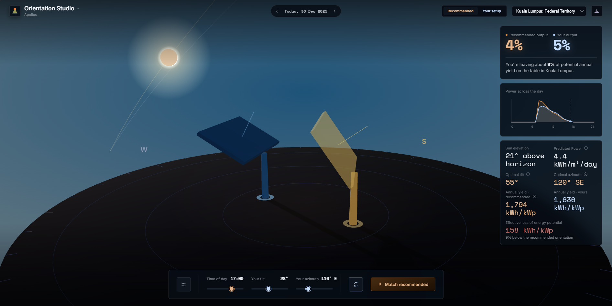

# Developing a Dashboard for Solar Irradiance Prediction and Panel Orientation Recommendations in Malaysian Cities

**Apolius — Solar Irradiance Forecasting & Panel Orientation Studio**

An end-to-end machine learning application that predicts solar irradiance and provides photovoltaic (PV) panel orientation recommendations across 15 Malaysian cities.

**Tech Stack:** Python · TensorFlow/Keras · Scikit-learn · Pandas · NumPy · SciPy · pvlib · FastAPI · HTML · CSS · JavaScript · Three.js



## Overview

Solar energy generation depends on environmental conditions, geographical location, and the orientation of photovoltaic panels. Suboptimal panel tilt and azimuth angles can reduce potential energy capture, particularly as the sun's position changes throughout the year.

This project addresses these challenges by combining **machine learning-based solar irradiance forecasting** with **physics-based mathematical modelling** to recommend suitable panel orientations for Malaysian cities.

The application integrates historical meteorological data, time-series forecasting, solar energy simulations, and an interactive 3D dashboard to help users understand how panel orientation affects potential energy yield.

Developed as a Final Year Project for the BSc (Hons) Computer Science (Data Analytics) programme at Asia Pacific University of Technology & Innovation (APU).

## Table of Contents

- [Overview](#overview)
- [Objectives](#objectives)
- [Key Features](#key-features)
- [System Architecture](#system-architecture)
- [Dataset & Preprocessing](#dataset--preprocessing)
  - [Geographic Coverage](#geographic-coverage)
  - [Feature Engineering](#feature-engineering)
  - [Data Splitting](#data-splitting)
- [Machine Learning Development](#machine-learning-development)
  - [Linear Regression](#linear-regression)
  - [Long Short-Term Memory (LSTM)](#long-short-term-memory-lstm)
  - [Transformer](#transformer)
  - [Weighted Ensemble](#weighted-ensemble)
- [Model Evaluation](#model-evaluation)
  - [Example Recorded Results](#example-recorded-results)
- [Solar Panel Orientation Optimisation](#solar-panel-orientation-optimisation)
- [Interactive Dashboard](#interactive-dashboard)
- [Getting Started](#getting-started)
  - [Prerequisites](#prerequisites)
  - [Start the FastAPI Backend](#1-start-the-fastapi-backend)
  - [Start the Frontend](#2-start-the-frontend)
  - [Explore the Dashboard](#3-explore-the-dashboard)
- [Limitations](#limitations)
- [Future Improvements](#future-improvements)
- [Technologies & References](#technologies--references)
- [Academic Information](#academic-information)

## Objectives

1. Develop and evaluate machine learning models to predict solar irradiance using historical meteorological data.
2. Recommend optimal panel tilt and azimuth through mathematical simulation and grid-search optimisation.
3. Deploy an interactive dashboard to visualise irradiance predictions and panel orientation recommendations.

## Key Features

- **24-hour forecasting:** Predicts 24 hourly Global Horizontal Irradiance (GHI) values using the preceding 24-hour input window.
- **15 Malaysian cities:** Supports location-specific predictions and recommendations.
- **Model comparison:** Evaluates Linear Regression, LSTM, Transformer, and weighted ensemble methods.
- **Orientation optimisation:** Uses pvlib mathematical models to simulate solar energy capture across different panel orientations.
- **Energy yield comparison:** Estimates potential solar-gain losses from user-selected orientations.
- **Interactive 3D dashboard:** Visualises panel tilt, azimuth, and solar positioning using Three.js.
- **FastAPI integration:** Connects forecasting results and solar orientation recommendations to the frontend.

## System Architecture

```text
NASA POWER Hourly Dataset
           |
           v
Data Cleaning & Feature Engineering
           |
           v
Chronological Train/Validation/Test Split
           |
           v
24-Hour Input/Output Windowing
           |
           v
Machine Learning Models
  |-- Linear Regression
  |-- LSTM
  |-- Transformer
  |-- Weighted Ensemble
           |
           v
24-Hour GHI Forecast
           |
           v
pvlib Mathematical Simulation
           |
           v
Tilt & Azimuth Grid-Search Optimisation
           |
           v
FastAPI Backend
           |
           v
Apolius Interactive Dashboard
```

## Dataset & Preprocessing

**Data Source:** [NASA POWER](https://power.larc.nasa.gov/)

The project uses hourly meteorological and solar irradiance data covering 15 cities across Malaysia, with observations extending through 31 December 2025.

### Geographic Coverage

Johor Bahru, Alor Setar, Kota Bharu, Kuala Lumpur, Bandar Melaka, Seremban, Kuantan, George Town, Ipoh, Kangar, Putrajaya, Kota Kinabalu, Kuching, Shah Alam, and Kuala Terengganu.

### Feature Engineering

The forecasting pipeline uses 14 input features covering geographical, atmospheric, temporal, and historical irradiance information.

These include:

- Latitude and cloud coverage
- Surface skin temperature and relative humidity
- Wind speed and cyclical wind-direction features
- Precipitable water and transformed rainfall
- Daylight indicators and cyclical hour encoding
- Historical GHI lag features (1 hour and 24 hours)

### Data Splitting

| Parameter | Configuration |
|---|---|
| Prediction target | GHI (W/m²) |
| Input window | 24 hours |
| Forecast horizon | 24 hours |
| Training | 70% |
| Validation | 10% |
| Testing | 20% |
| Split strategy | Chronological |

## Machine Learning Development

### Linear Regression

Implemented as a baseline model to establish reference performance against deep learning approaches.

### Long Short-Term Memory (LSTM)

Developed an LSTM-based neural network to capture temporal dependencies between historical meteorological conditions and solar irradiance.

The model generates a direct 24-hour forecast from the preceding 24-hour input sequence.

### Transformer

Implemented an encoder-based Transformer architecture to evaluate attention-based time-series forecasting.

Experiments included last-token pooling to preserve information from the most recent input timestep.

### Weighted Ensemble

Developed weighted ensemble experiments to combine predictions from individual model families.

The three-model implementation uses SciPy's Sequential Least Squares Programming (SLSQP) optimiser to minimise validation-period RMSE.

Optimised weights are constrained to be non-negative and sum to 1 before being applied to held-out test data.

## Model Evaluation

The models are evaluated using MAE, RMSE, MSE, R², MBE, and normalised RMSE.

Evaluation experiments include standard windowed prediction and rolling-origin next-day forecasting.

### Example Recorded Results

| Model / Experiment | RMSE (W/m²) | R² |
|---|---:|---:|
| LSTM — recorded rolling-origin evaluation | 69.75 | 0.9354 |
| LSTM — dashboard standard-windowed test table | 67.13 | 0.9402 |

These values originate from different recorded evaluation procedures and should not be treated as directly comparable. The complete model comparison should refer to the corresponding experiment outputs.

## Solar Panel Orientation Optimisation

The predicted irradiance is integrated with solar energy modelling to estimate the potential energy captured by differently oriented photovoltaic panels.

Using pvlib-based calculations and a grid-search optimisation approach, the application evaluates candidate tilt and azimuth combinations.

The recommended orientation is selected based on the modelled solar energy yield under the simulation assumptions.

The dashboard allows users to compare their own panel orientation against the recommended configuration, including estimated relative yield losses.

## Interactive Dashboard

The application features **Apolius Orientation Studio**, an interactive visualisation interface developed using HTML, CSS, JavaScript, and Three.js.

Users can:

- Select from 15 Malaysian cities.
- View irradiance predictions and recommended panel orientation.
- Adjust panel tilt and azimuth angles.
- Compare simulated energy yield between configurations.
- Explore solar positioning in a 3D environment.
- Review model evaluation metrics and comparisons.

The dashboard communicates with the Python backend through FastAPI.

## Getting Started

### Prerequisites

- Python and the project dependencies
- Required trained model and preprocessing artifacts
- Modern web browser with JavaScript and WebGL support

### 1. Start the FastAPI Backend

Open a terminal in the directory containing `main.py`.

Install the dependencies specified by the backend environment configuration.

Start the application using:

```bash
uvicorn main:app --reload --port 8000
```

The API will be available at:

`http://127.0.0.1:8000`

Interactive FastAPI documentation, when enabled, can be accessed at:

`http://127.0.0.1:8000/docs`

### 2. Start the Frontend

Open another terminal in the directory containing `index.html` and `dashboard.html`.

Start a local HTTP server:

```bash
python -m http.server 5500
```

Open the dashboard:

`http://127.0.0.1:5500/index.html`

Ensure the backend is running for model inference and API-driven results.

### 3. Explore the Dashboard

Select a Malaysian city, explore the forecast results, and adjust the panel tilt and azimuth to compare estimated energy yield with the recommended orientation.

## Limitations

- Model performance depends on the quality and geographical coverage of historical NASA POWER data.
- Different training runs and evaluation procedures may produce slightly different metrics.
- The application does not currently provide a live meteorological data feed; historical replay may be used for demonstration.
- Simulated orientation recommendations do not account for every real-world installation factor, including shading, roof constraints, panel degradation, and equipment characteristics.
- Estimated energy yield represents modelled performance rather than guaranteed electricity generation.

## Future Improvements

Potential extensions include integration with live weather forecasts, additional geographic locations, broader model evaluation, and validation against measured photovoltaic generation.

## Technologies & References

- [NASA POWER](https://power.larc.nasa.gov/)
- [TensorFlow](https://www.tensorflow.org/)
- [Scikit-learn](https://scikit-learn.org/)
- [SciPy](https://scipy.org/)
- [pvlib Python](https://pvlib-python.readthedocs.io/)
- [FastAPI](https://fastapi.tiangolo.com/)
- [Three.js](https://threejs.org/)

## Academic Information

**Project Title:** Developing a Dashboard for Solar Irradiance Prediction and Panel Orientation Recommendations in Malaysian Cities.

**Project Type:** Final Year Project

**Institution:** Asia Pacific University of Technology & Innovation (APU)

**Programme:** BSc (Hons) Computer Science (Data Analytics)

**Author:** Chong Kelvin

---

*This project was developed for academic research and demonstration purposes. Solar energy predictions and orientation recommendations are simulation-based estimates and should not be interpreted as guarantees of actual photovoltaic system performance.*